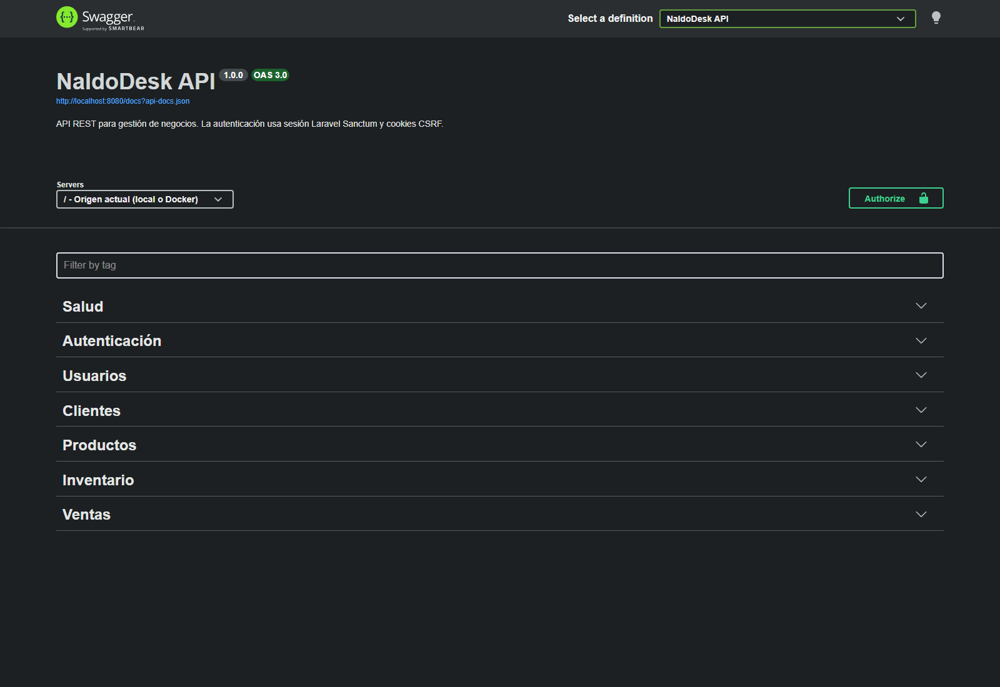
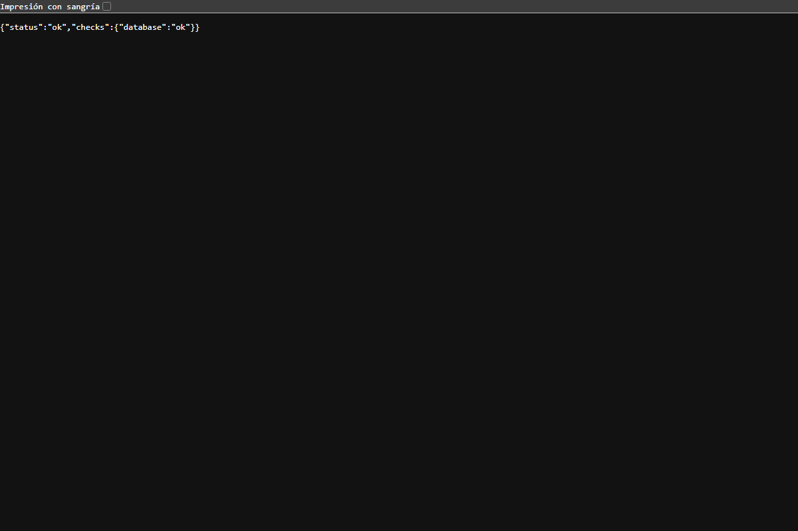

# Evidencias del portafolio local

Verificación realizada el 22 de octubre de 2026 con el stack local de Docker Compose. Las capturas no incluyen credenciales.

## Swagger UI

La interfaz carga la especificación OpenAPI y usa `/` como origen, por lo que las solicitudes van al mismo host y puerto donde se abrió Swagger (Docker: `http://localhost:8080`).



## Salud de la API

`GET /api/health` respondió `status: ok` y `database: ok`.



## Verificaciones automatizadas

- PHPUnit: **28 pruebas aprobadas, 128 aserciones**. Incluye autenticación, aislamiento por negocio, ventas e inventario, integración de Redis y formato JSON de errores API.
- Jest: **5 pruebas aprobadas** con la integración de Redis y Socket.io habilitada. La verificación conectó el servicio realtime con el Redis de Compose.
- Pint: análisis de formato PHP ejecutado; se corrigieron dos hallazgos y luego se validaron nuevamente los archivos modificados.
- Rutas REST: Laravel registró 19 rutas bajo `/api`.
- API protegida: `GET /api/clients` sin sesión devolvió HTTP 401 y JSON, aun sin encabezado `Accept`.

## Reproducir las verificaciones principales

Desde la raíz del repositorio, con Docker iniciado y `.env.docker` preparado:

```powershell
docker compose --env-file .env.docker up -d
docker compose --env-file .env.docker --profile test run --build --rm tests
Invoke-RestMethod http://localhost:8080/api/health
curl.exe -i http://localhost:8080/api/clients
```

Para comandos de Jest y el modo de integración, consulta [`docs/fase-9-testing.md`](fase-9-testing.md); para iniciar el entorno completo, consulta [`docs/fase-10-docker.md`](fase-10-docker.md).

## Alcance de la evidencia

Estas evidencias muestran el backend y sus servicios locales. La interfaz React todavía no forma parte del alcance implementado. No se publicó el proyecto ni se desplegó infraestructura en AWS.
